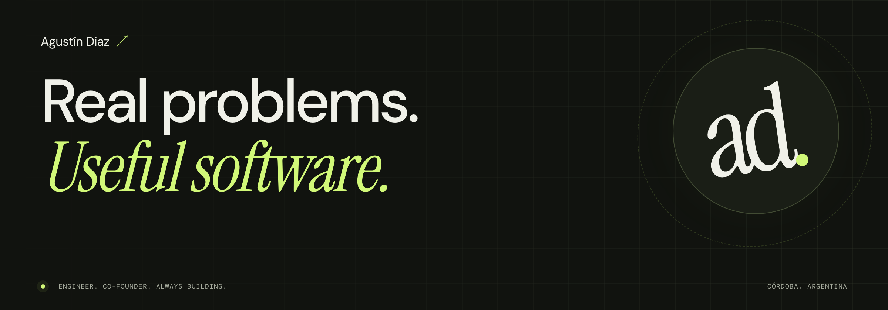
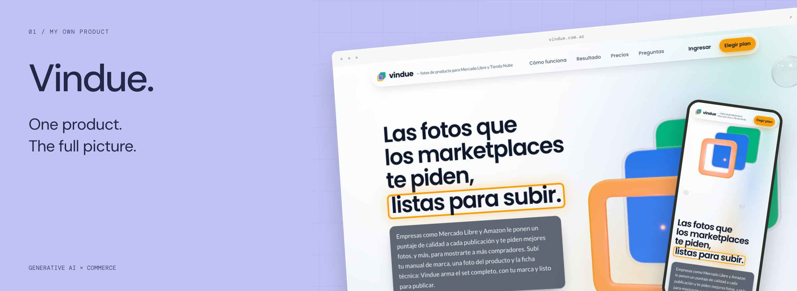
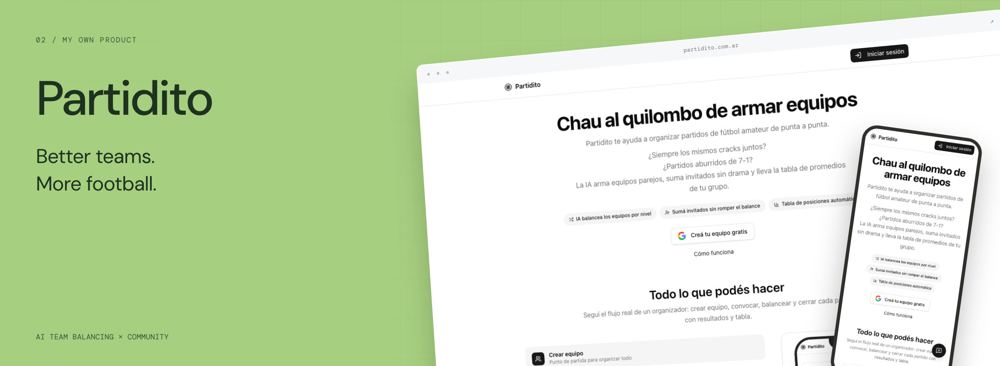
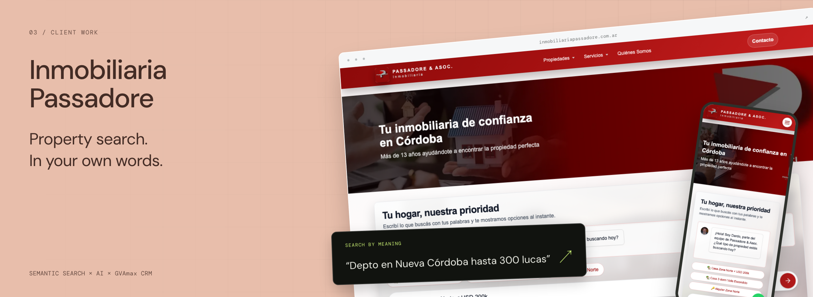

**Sr. AI Software Engineer @ MercadoLibre · Co-founder of Lessio & Co**

I sell products and build the tools I wish existed. Some become products of their own.

At Lessio & Co, I’m on both sides of the screen: running a physical-products business and building the software behind it.

**[Explore my work ↗](https://adiazgallici.vercel.app)** · [What I’m doing now](https://adiazgallici.vercel.app/now) · [Notes from the build](https://adiazgallici.vercel.app/log)

## Selected work

### Vindue

From a product brief to a complete marketplace image gallery. Brand guidelines, shot planning, generation, adjustments and export. **Lessio & Co was the first test case.**

[Visit Vindue ↗](https://vindue.com.ar) · [The story behind it](https://adiazgallici.vercel.app/projects/vindue)

### Partidito

Less arguing in the group chat. More football. Organize matches, **balance teams with AI**, track standings and let the group rate players through a link shared on WhatsApp.

[Try Partidito ↗](https://www.partidito.com.ar) · [The project](https://adiazgallici.vercel.app/projects/partidito)

### Inmobiliaria Passadore

**AI-powered semantic property search** for a real estate agency in Córdoba. It interprets everyday Argentine Spanish, neighborhoods and budgets, then turns the request into structured filters over CRM-backed listings.

[Visit the agency ↗](https://www.inmobiliariapassadore.com.ar) · [How the search works](https://adiazgallici.vercel.app/projects/passadore)

## Built for our business

**I don’t just build for sellers. I am one.**

- **[Lessio & Co storefront](https://adiazgallici.vercel.app/projects/lessio-store)** — a mobile-first shopping experience for our brand. More ownership of how we sell, what we say and what we learn.
- **[Lessio Stock](https://adiazgallici.vercel.app/projects/lessio-stock)** — the internal system behind our business: inventory, marketplace orders, shipments, costs and an audit trail.

## Now building

- **Vindue:** taking a tool born inside our business and building it for other sellers.
- **Our own storefront:** shaping the mobile experience and moving from Tiendanube step by step.
- **A place to show the work:** project stories now; a build log next.

[More on my Now page ↗](https://adiazgallici.vercel.app/now)

## Small things, shipped

**[isclaude-2x](https://github.com/Adiazgallici/isclaude-2x)** — a small Claude Code statusline, built and published for the March 2026 usage promotion. A useful little tool for a specific moment.

552 npm downloads over the past year · 8 stars · 1 fork. [Package ↗](https://www.npmjs.com/package/isclaude-2x)

A few numbers, with context

**1,388 commits across these six project histories.**

| Project | Commits |
| --- | ---: |
| Vindue | 119 |
| Partidito | 220 |
| Inmobiliaria Passadore | 148 |
| Lessio & Co storefront | 191 |
| Lessio Stock | 705 |
| isclaude-2x | 5 |

Snapshot: October 21, 2026. Counts cover each repository’s default-branch history, including merges and collaborators. They are not a count of my personal contributions. npm window: October 19, 2025 – October 18, 2026. The Claude promotion ran March 13–28, 2026.

---

Most of the source stays private. Here I share the products, screenshots and stories behind them.

**Built in Córdoba, Argentina.** [Follow the work ↗](https://adiazgallici.vercel.app)
