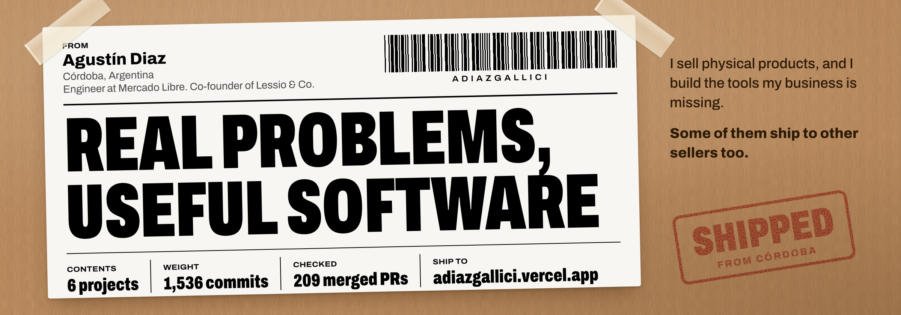

I sell physical products with **Lessio & Co**, and I build the tools the business is missing. Some of them ship to other sellers too. By day, I’m a Sr. AI Software Engineer at Mercado Libre.

**[Visit my portfolio](https://adiazgallici.vercel.app)** or see [what I’m working on now](https://adiazgallici.vercel.app/now).

## Products

**[Vindue](https://vindue.com.ar)** started with our own Mercado Libre listings. Give it one product brief and it plans the shots, generates a complete on-brand gallery and exports it ready to upload. Now it’s open to other sellers. [Read the story](https://adiazgallici.vercel.app/projects/vindue)

**[Partidito](https://www.partidito.com.ar)** runs the weekly football match. AI balances the teams, standings update after every game and the group rates players through a link shared on WhatsApp. [See the project](https://adiazgallici.vercel.app/projects/partidito)

## Client work

**[Inmobiliaria Passadore](https://www.inmobiliariapassadore.com.ar)** lets people search homes the way they’d say it. An AI model turns “depto en Nueva Córdoba hasta 300 lucas” into structured filters over listings synced from the agency’s CRM. [How the search works](https://adiazgallici.vercel.app/projects/passadore)

## Built for our business

**I don’t just build for sellers. I am one.**

**[Lessio & Co storefront](https://lessioandco.vercel.app)** is our own mobile-first store. We’re moving off Tiendanube one step at a time, so we own the experience, the content and what we learn from it. [See the storefront](https://adiazgallici.vercel.app/projects/lessio-store)

**[Lessio Stock](https://adiazgallici.vercel.app/projects/lessio-stock)** is the back office behind the business: stock at home and in Mercado Libre FULL, order sync, shipments to FULL, supplies and costs. It’s our biggest codebase and it stays private, so the screenshots use demo data.

## Small things, shipped

**[isclaude-2x](https://github.com/Adiazgallici/isclaude-2x)** is a Claude Code statusline I published for the March 2026 usage promotion. It showed whether you were in the 2x window and how long until it changed. 553 npm downloads in the past year, 8 stars. [View the package](https://www.npmjs.com/package/isclaude-2x)

Where the numbers come from

| Project | Commits | Merged PRs |
| --- | ---: | ---: |
| Lessio Stock | 733 | 90 |
| Lessio & Co storefront | 283 | 0 |
| Partidito | 220 | 67 |
| Inmobiliaria Passadore | 153 | 49 |
| Vindue (app and landing) | 142 | 2 |
| isclaude-2x | 5 | 1 |
| **Total** | **1,536** | **209** |

Counted on October 24, 2026 from each repository’s default branch, including merge commits and collaborators, so they are not a count of my personal contributions. npm downloads cover October 23, 2025 to October 22, 2026.

---

Most of the source stays private. Here you get the products, real screenshots and the stories behind them.

**Built in Córdoba, Argentina.** [adiazgallici.vercel.app](https://adiazgallici.vercel.app)
