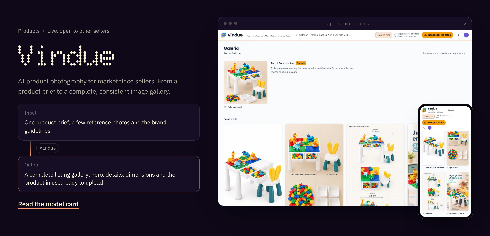
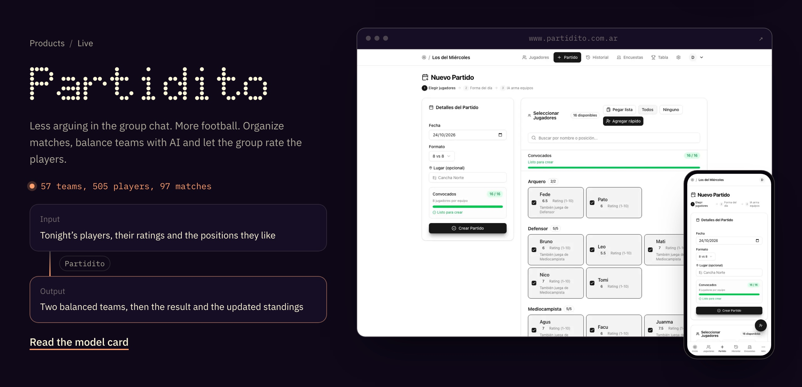
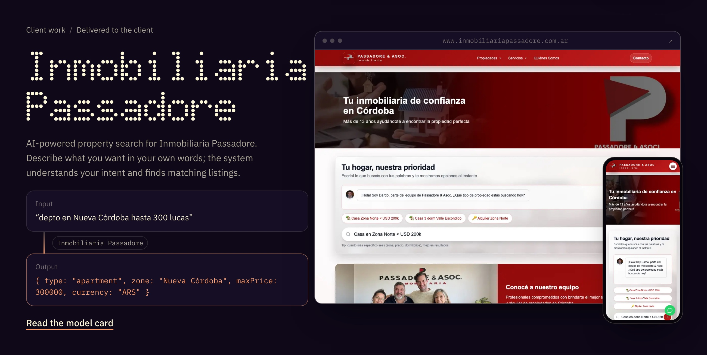
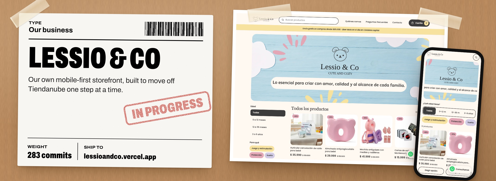
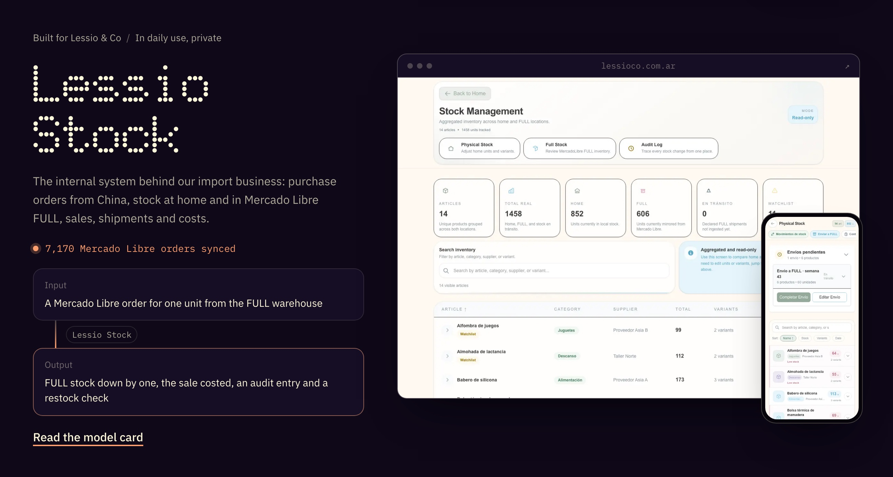
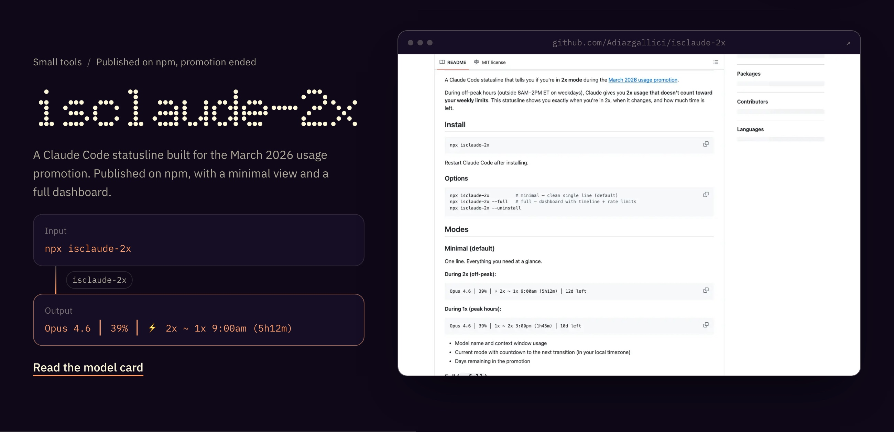

With Lessio & Co, I import products and sell them online, and I build the tools the business is missing. Some of them become products for other sellers. I’m also a Sr. AI Software Engineer at Mercado Libre.

**[See the work](https://adiazgallici.vercel.app)** or read [what I’m building now](https://adiazgallici.vercel.app/now).

## What goes in, what comes out

Every project, described by one real input and the output it produces.

**[Try Vindue](https://vindue.com.ar)** or read its [model card](https://adiazgallici.vercel.app/projects/vindue).

**[Try Partidito](https://www.partidito.com.ar)** or read its [model card](https://adiazgallici.vercel.app/projects/partidito).

**[Visit the agency](https://www.inmobiliariapassadore.com.ar)** or read the [model card](https://adiazgallici.vercel.app/projects/passadore).

**[See the store](https://lessioandco.com.ar)** or read its [model card](https://adiazgallici.vercel.app/projects/lessio-store).

**Lessio Stock** is private and in daily use, so the screenshots use invented demo data. Read its [model card](https://adiazgallici.vercel.app/projects/lessio-stock).

**[See the source](https://github.com/Adiazgallici/isclaude-2x)** or the [npm package](https://www.npmjs.com/package/isclaude-2x): 553 downloads in the past year, 8 stars.

Where the numbers come from

| Project | Commits | Merged PRs |
| --- | ---: | ---: |
| Lessio Stock | 776 | 92 |
| Lessio & Co storefront | 283 | 0 |
| Partidito | 220 | 67 |
| Inmobiliaria Passadore | 153 | 49 |
| Vindue | 124 | 2 |
| isclaude-2x | 5 | 1 |
| **Total** | **1,561** | **211** |

Counted on October 24, 2026 from each repository’s default branch, including merge commits and collaborators, so they are not a count of my personal contributions. npm downloads cover October 23, 2025 to October 22, 2026.

---

Most of the source stays private. The products and screenshots are real.

**Made in Argentina.** [adiazgallici.vercel.app](https://adiazgallici.vercel.app)
